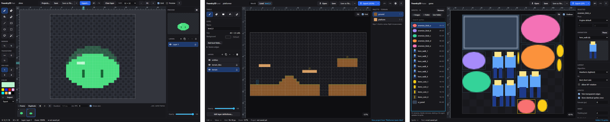
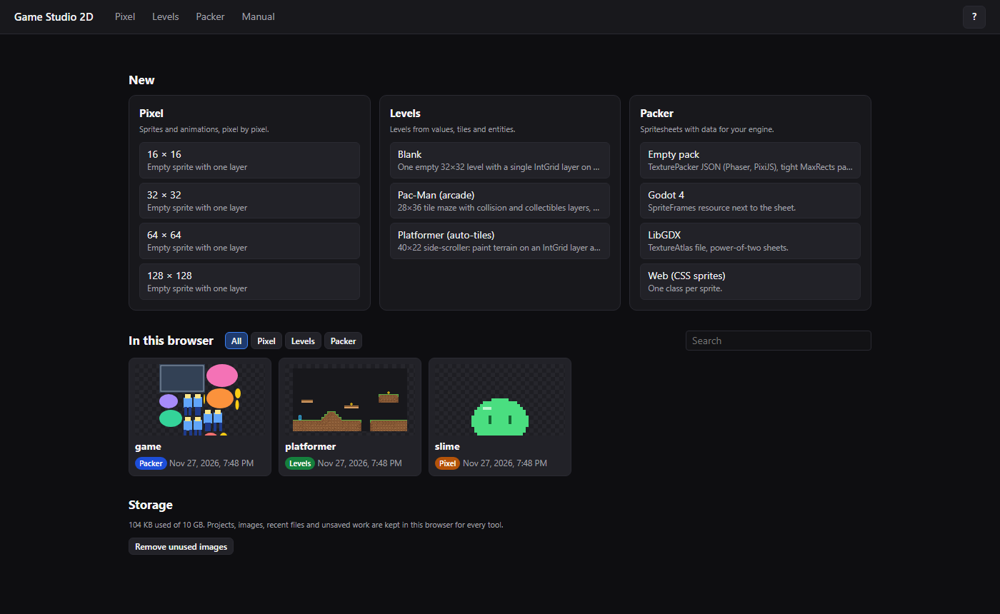

# Game Studio 2D

A studio of tools for 2D games, built on one shared engine. Three apps today, which work on their own and together:

| App        | What it is for                                                                                                                                                                                       |
| ---------- | ---------------------------------------------------------------------------------------------------------------------------------------------------------------------------------------------------- |
| **Pixel**  | Drawing sprites pixel by pixel, with layers, frames, onion skin and an animated preview. Exports images, GIFs and spritesheets with data for game engines.                                           |
| **Levels** | Building levels from grids of values, tiles and placed entities, laid out in a world. Tiles can be generated from rules (auto-layers). Exports game JSON, Game Studio 2D contracts, CSV and PNG.     |
| **Packer** | Packing many images into spritesheets: trimming, rotation, identical sprites stored once, several sheets when needed, animations and pivots. Writes data for Phaser, PixiJS, Godot, LibGDX and more. |





They run in any modern browser and keep your work there (with crash recovery), or in files on your disk. In Chrome and Edge the studio installs as one app that works offline and opens every tool's files from the desktop.

The project was called Foundry2D until November 2026; its files (`.f2dsprite`, `.f2dlevel`, `.f2dpack`) still open, and work kept in the browser is carried over. Where it is going next (a desktop studio connected to your games) is in the [roadmap](docs/ROADMAP.md).

## Quick start

You need [Vite+](https://viteplus.dev/guide/) (the `vp` command) and Node.js.

```bash
vp install
```

Then start the studio with every tool:

```bash
vp run dev
```

and open http://localhost:3000/: the studio's start page, with unsaved work to continue, each tool's templates, everything saved in the browser and recent files. The tools are at `/pixel/`, `/levels/` and `/packer/`, the manual at `/docs/`, all on one site so they share your saved work. To build the whole site into `build/site/`:

```bash
vp run build:site
```

## Documentation

- **[User manual](docs/manual/README.md)**: every tool, panel and dialog, step-by-step workflows, the file formats, and keyboard shortcuts. `vp run dev:docs` serves it as a site (port 3003) with search.
- **[Architecture](docs/architecture.md)**: the packages and how documents, commands, rendering, the workspace and storage fit together.
- **[Asset contracts](docs/contracts.md)** (draft): the files the tools write into a game.
- **[Technologies](docs/technologies.md)**: what the project is built with, and why.
- **API reference**: generated from the source comments with `vp run docs` (into `docs/api/`).
- **[Contributing](docs/CONTRIBUTING.md)**: setup, the checks to run, conventions and toolchain quirks.
- **[Roadmap](docs/ROADMAP.md)**: what was built when, decisions, and what is next.

## Repository layout

```
apps/
  studio/           the studio: the site's start page and dev server
  pixel/            Pixel
  levels/           Levels (presets/ holds its project templates)
  packer/           Packer
  docs/             the manual site
packages/
  core/             documents, layers, tools, commands, selection, storage, ZIP (no DOM)
  render/           canvas render passes (layers, grid, cursor, rulers)
  workspace/        the canvas workspace, input, key map, and the file workflow
  ui/               web components, the shared theme and DOM helpers
  atlas/            rectangle packing and sheet building (no DOM)
  formats/          spritesheet data formats for game engines
  store/            a small validated state store for UI state
docs/               this documentation
e2e/                end-to-end tests (Playwright)
scripts/            docs generation
```

## Checks

```bash
vp check --fix
```

```bash
vp run -r test
```

```bash
vp run test:e2e
```
