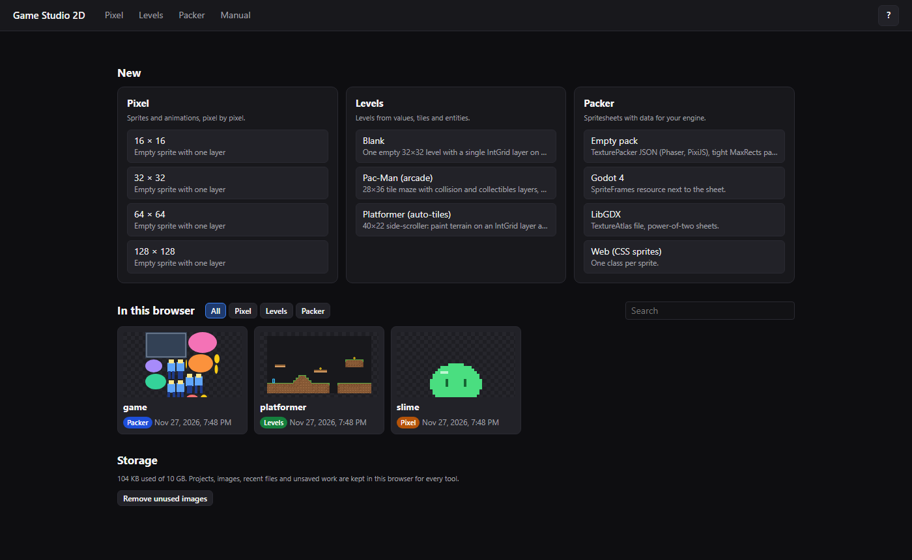

# The three apps

Game Studio 2D is three editors for 2D games that share one engine and one look. Each opens in its own browser tab (or app window, once installed) and keeps its own work.

| App        | Use it to…                                                                                    | Work file     |
| ---------- | --------------------------------------------------------------------------------------------- | ------------- |
| **Pixel**  | draw sprites and animations pixel by pixel, and export images, GIFs and spritesheets.         | `.gs2dsprite` |
| **Levels** | build levels on grids: collision and other values, tiles, and placed objects with properties. | `.gs2dlevel`  |
| **Packer** | pack many images into spritesheets with data for a game engine.                               | `.gs2dpack`   |

## The studio

The tools are parts of one site: the studio's start page at the root, and the tools at `pixel/`, `levels/` and `packer/` next to it, with the manual at `docs/`. They share what the browser keeps for them, so the start page shows the work of every tool (see [Projects, saving and files](02-projects-and-files.md)).

## How they work together

- A sprite from **Pixel** can become a **tileset** in Levels (Project settings → Tilesets → Import…), and it can be re-imported after you change it. See [A sprite as a tileset](../03-levels/09-workflow-tileset.md).
- **Packer** reads Pixel sprites frame by frame, so a character drawn there joins the rest of a game's art on one sheet.
- Pixel has its own spritesheet export for a single sprite; Packer is for a whole folder of images.

## What you need

- A current **Chrome, Edge, Firefox or Safari**. Everything works in all of them, with two extras in Chrome and Edge: saving back to the file you opened (instead of downloading a copy), and Packer's live folders.
- Nothing to install, and no account. Your work stays on your computer: in the browser's storage and in the files you save.

## Installing the studio

In Chrome and Edge, install the studio from its start page (the install icon in the address bar, or the browser menu → Install). The installed studio:

- opens in its own window, with every tool in it, and works offline (its first start gets every tool ready);
- opens work files when you double-click them on the desktop or in your file manager (`.gs2dsprite`, `.gs2dlevel`, `.gs2dpack`, and the older `.f2d*` ones), each in its tool;
- tells you when a new version is ready, and switches only when you choose **Reload**.

Each tool can still be installed on its own, but only the studio opens files from the desktop.

## Getting around

Each tool's toolbar starts with a **house** button that goes back to the studio's start page. From there, or from the links at its top, you reach every tool and the manual.

## Help and the tour

The first time you open an app, a short **tour** points out its parts: tools, panels, saving and exporting. Use **Next** and **Back** (or the arrow keys), and **Skip tour** or **Esc** to leave it. It doesn't come back by itself.

The **?** button at the right end of each app's toolbar opens **Help**:

- **Take the tour** shows the tour again.
- **Manual** opens this manual, and **Keyboard shortcuts** the app's list of keys.

When a new version adds something worth knowing, a short "what's new" tour shows it once.
