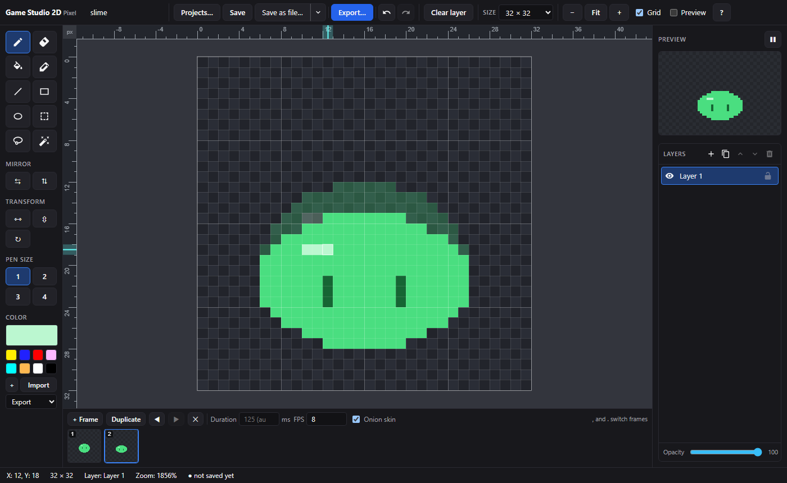

# A tour of Pixel

Pixel is for drawing sprites: small images, often animated, edited one pixel at a time.

## The window

- **Toolbar (top):** the sprite's name, **Projects…** (the start screen), **Save**, **Save as**, **Export…**, undo and redo, **Clear layer**, the canvas **Size**, zoom buttons, and the **Grid** and **Preview** checkboxes.
- **Tools column (left):** the drawing and selection tools, **Mirror**, **Transform**, **Pen size**, and **Color** with the palette.
- **Canvas (middle):** the current frame, with rulers and the grid.
- **Timeline (below the canvas):** the frames, their actions, each frame's duration, the FPS and onion skin.
- **Side column (right):** the animated **Preview** and the **Layers** panel.
- **Status bar (bottom):** the pixel under the pointer, the sprite size, the active layer, the zoom and where the sprite is saved.

## A sprite

A sprite has a size (8 × 8 up to 128 × 128 in the **Size** list), one or more **layers** and one or more **frames**. Every frame has the same layers, so you can add a layer for a hat and draw it in every frame of a walk cycle. The palette is saved with the sprite.

Changing the **Size** resizes every frame. Growing adds empty pixels on the right and bottom; shrinking crops there. Undo brings cropped pixels back.

## Focus and preview

Normally the layers you are not editing are dimmed, so the active one stands out (**focus**). Tick **Preview** (Alt+P) to see the sprite as it will be exported: every visible layer at its opacity, without onion skin or mirror guides.

## Undo

Every change is one step: a stroke, a shape, a move, a layer or frame edit, a resize. **Ctrl+Z** undoes and **Ctrl+Shift+Z** or **Ctrl+Y** redoes. Undo also brings back the selection a step had.
