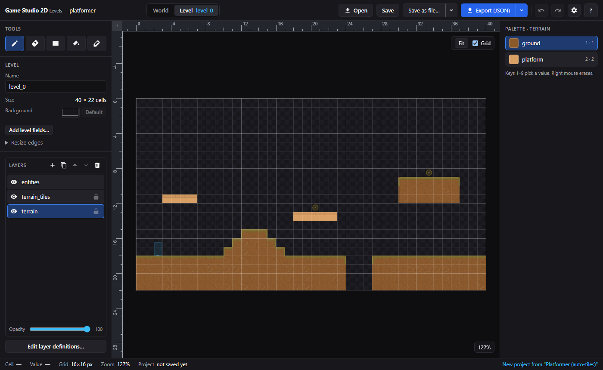

# Concepts and a tour

Levels builds the levels of a game on grids. It follows the model of [LDtk](https://ldtk.io/), simplified.

## Concepts

- A **project** holds a **world** of **levels**, and the **definitions** they share.
- A **level** is a rectangle of cells (its size in cells times the **grid size** in pixels, 8 px in the Pac-Man preset). Each level has its own name, background, field values and content.
- **Layers** are defined once for the whole project and exist in every level. There are three types:
  - **IntGrid:** a number per cell, each with a name and colour, for things like walls, water or pellets. Games read these as data.
  - **Tiles:** a tile from a **tileset** image per cell, painted by hand or **generated** from an IntGrid layer by rules (an auto-layer).
  - **Entities:** objects placed anywhere, like the player, enemies or doors, with **fields** (properties such as health or a target).
- **Definitions** are edited in **Project settings** (the gear button): layers, tilesets, entity types, enums and level fields. They are undoable like everything else.

## Two views

- **World:** all levels laid out, to arrange them. The left side lists the levels and the world layout.
- **Level:** one level, to paint it. The left side has the tools, the level's properties and the layers; the right side has the palette for the active layer.

Switch with the **World** and **Level** tabs in the toolbar, **Enter** (open the selected level) and **Esc** (back to the world). A project with one level opens straight into it.

## The window

- **Toolbar:** project name, the view tabs, **Open**, **Save**, **Save as**, **Export** (the arrow picks the format), undo, redo, and **Project settings**.
- **Left sidebar:** in the world view, the **World** layout and the **Levels** list; in the level view, **Tools**, **Level** and **Layers**.
- **Canvas:** with **Fit** and **Grid** in its corner and the zoom.
- **Right sidebar (level view):** the **Palette** of the active layer: IntGrid values, the tileset picker, or the entity list and inspector.
- **Status bar:** the cell and value under the pointer, the grid, the zoom and where the project is saved.

## Starting

**Open** (Ctrl+O) → **New** offers the presets:

- **Blank:** one empty 32 × 32 level with one IntGrid layer on a 16 px grid.
- **Pac-Man (arcade):** the 28 × 36 maze on an 8 px grid, with collision and collectibles layers and Pac-Man, ghost and fruit entities. See [Build a Pac-Man maze](08-workflow-pacman.md).
- **Platformer (auto-tiles):** a 40 × 22 side-scroller where you paint terrain and rules place grass, dirt, edges and planks.
