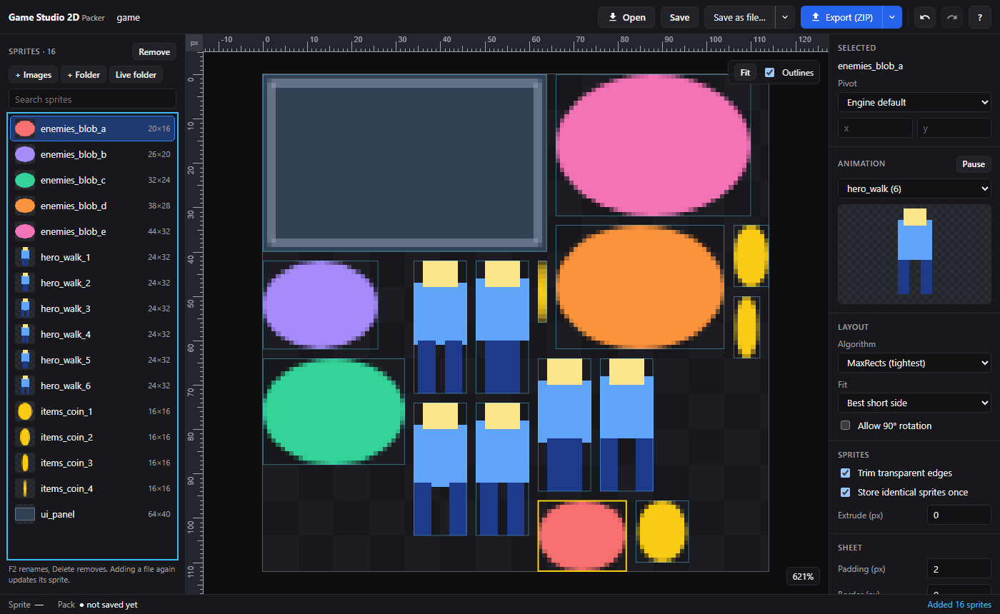

# A tour of Packer

Packer takes many separate images and packs them onto as few sheets as possible, with a data file that tells a game engine where each sprite is. Engines draw from one sheet much faster than from hundreds of small images.

## The window

- **Toolbar:** the pack's name, **Open**, **Save**, **Save as**, **Export** (the arrow picks a ZIP or separate files), undo and redo.
- **Sprites (left):** **+ Images**, **+ Folder** and **Live folder**, a search field and the list of sprites. **Remove** deletes the selected ones.
- **Sheets (middle):** the packed sheets side by side, redrawn as you change anything. **Outlines** shows each sprite's rectangle; **Fit** (F) fits them in view. Click a sprite to select it.
- **Settings (right):** the selected sprites' **Pivot**, the **Animation** preview, the packing settings, and the **Result**: sheet sizes, how full they are and how many sprites were shared.
- **Status bar:** the sprite under the pointer, where the pack is saved, and messages.

## How it works

You add images; each becomes a **sprite** named after its file (with folders: `enemies/bat`). The pack stores the original files and the settings, never a finished sheet: the sheets are rebuilt from them whenever something changes, in the background, so the page stays responsive even with hundreds of sprites. Every change is an undo step.

When you export, you get the sheet images and their data in the format you chose.

## Templates

**Open** → **New** offers packs set up for an engine:

- **Empty pack:** TexturePacker JSON for Phaser and PixiJS, tight MaxRects packing.
- **Godot 4:** a SpriteFrames resource next to the sheet.
- **LibGDX:** a TextureAtlas file, power-of-two sheets.
- **Web (CSS sprites):** one CSS class per sprite.

The format can be changed any time under **Data**.
